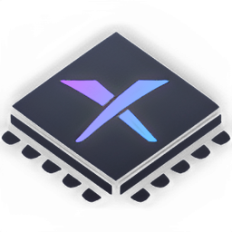
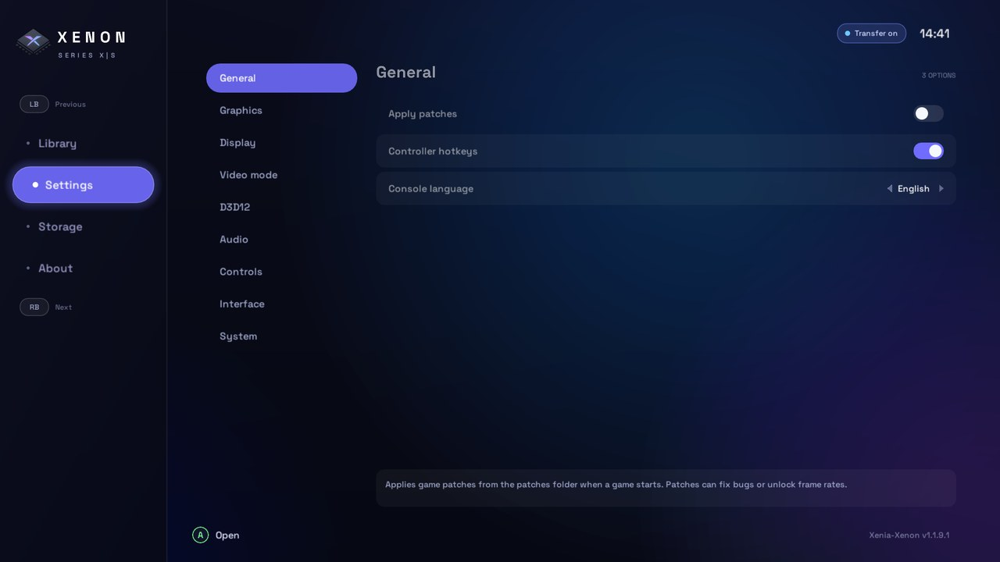
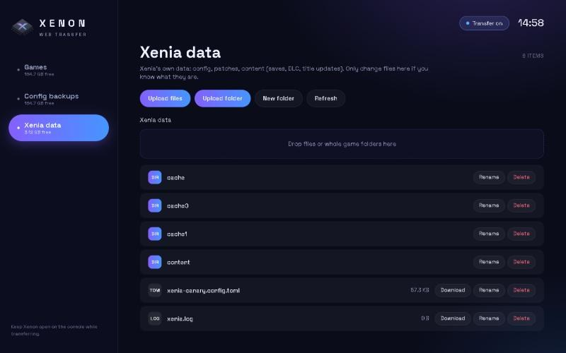
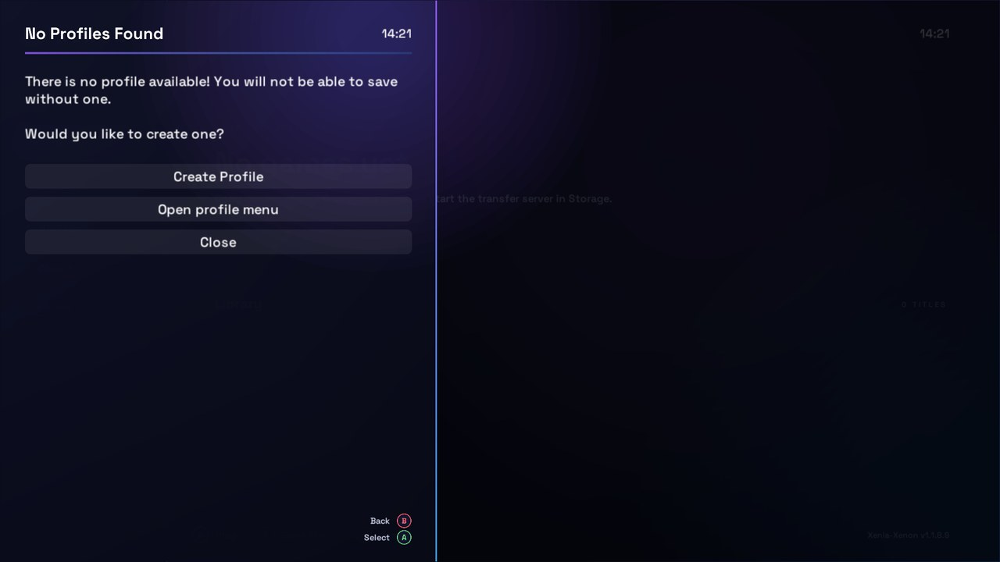
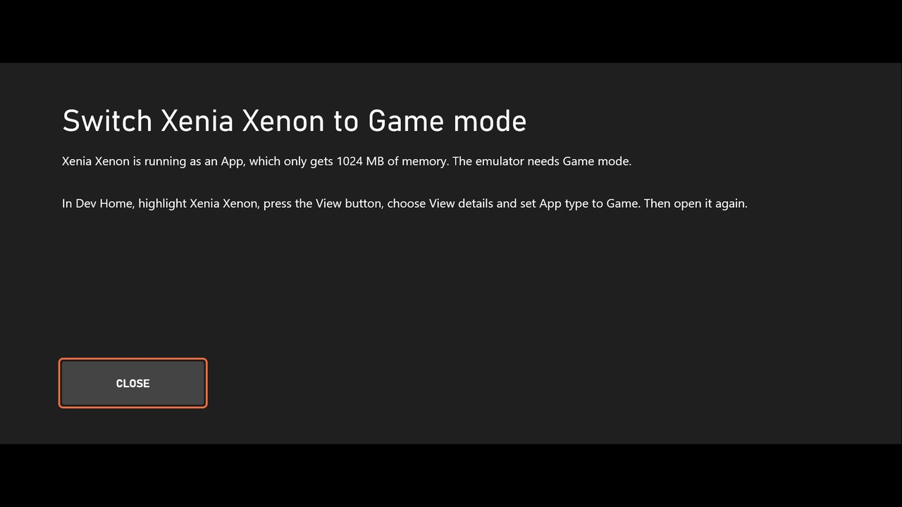

<p align="center">
    
</p>

<h1 align="center">Xenia-Xenon</h1>

<p align="center">Xbox 360 emulation for <b>Xbox Series X|S in Dev Mode</b> (UWP, Direct3D 12).</p>

Xenia-Xenon is an unofficial fork of [Xenia Canary](https://github.com/xenia-canary/xenia-canary)
built on the Xenia Canary UWP port. It is not associated with the Xenia developers.

<p align="center">
    
    
</p>

## Features

- **Console-first interface.** Sidebar with Library, Settings, Storage and About, made for the
  controller: LB/RB switch sections, the settings list stays put while only the options scroll,
  and every option has a plain-language description.
- **Own package.** Installs as **Xenia Xenon**, next to Xenia Canary without replacing it.
- **Internal game storage.** Games live in `D:\DevelopmentFiles\XeniaXenon\Games`, on the large
  Dev Mode partition, and show up in the library automatically.
- **Web file transfer.** A file manager you open from any browser (PC or phone) on the same
  network. Drop ISO / ZAR / GOD files or whole game folders, with progress, rename, delete,
  download and free space. No internet or extra software needed.
- **Config backups.** Export your settings from **Storage → Config backups**, import or delete
  them later, or copy them to a PC through the web transfer page.
- **Game mode check.** If the console runs Xenon as an *App* (1 GB memory limit), it tells you
  how to switch it to *Game* instead of closing.

<p align="center">
    
    
</p>

## Installing on Xbox (Dev Mode)

1. Put the console in Dev Mode and open Device Portal (`https://<console-ip>:11443`).
2. **Add** the `.appx` plus the `Microsoft.VCLibs.x64.14.00.appx` dependency.
3. In Dev Home, highlight **Xenia Xenon** → View button → **View details** → set **App type** to
   **Game**. Updates can reset this, so check it again after installing a new version.

## Copying games to the console

1. Open Xenon → **Storage** → **Web transfer** and turn the transfer server on (it stays on for
   the next launches).
2. Open the address shown (e.g. `http://192.168.1.20:8080`) in a browser on the same network.
3. Drop games into the **Games** section. A wired connection gives the best speed.

## Building

Needs Visual Studio 2022 Build Tools with *C++ (v143) Universal Windows Platform tools* and a
Windows 10/11 SDK.

```
git submodule update --init --depth 1
python xenia-build.py premake
msbuild xenia-canary-uwp\xenia-canary-uwp.vcxproj /p:Configuration=Release /p:Platform=x64 ^
  /p:SolutionDir=%CD%\xenia-canary-uwp\ /p:WindowsTargetPlatformVersion=10.0.26100.0 ^
  /p:AppxBundle=Never /p:UapAppxPackageBuildMode=SideloadOnly
```

Restore the `Microsoft.Windows.CppWinRT` NuGet package into `build\packages` first, and sign the
resulting `.appx` with a certificate whose subject matches the manifest publisher.

## Credits

Xenia and its contributors for the emulator, SirMangler for the original UWP port, danprice142
for the Xenia Canary UWP port, and Florian Karsten for the Space Grotesk font (SIL OFL).

<h1>Original Readme</h1>

Xenia Canary is an experimental fork of the Xenia emulator. For more information, see the
[Xenia Canary wiki](https://github.com/xenia-canary/xenia-canary/wiki).

Come Join the Xbox Emulation Hub Discord server for help, support and general dissusion: https://discord.gg/WCmxvvxHqu
For developer chat join `#dev` but stay on topic. Lurking is not only fine, but encouraged!
Please check the [FAQ](https://github.com/xenia-canary/xenia-canary/wiki/FAQ) page before asking questions.
We've got jobs/lives/etc, so don't expect instant answers.

Discussing illegal activities will get you banned.

## Status

Buildbot | Status | Releases
-------- | ------ | --------
Canary (🪟, 🐧) | [](https://github.com/xenia-canary/xenia-canary/actions/workflows/Orchestrator.yml/badge.svg?branch=canary_experimental) [](https://app.codacy.com/gh/xenia-canary/xenia-canary/dashboard?utm_source=gh&utm_medium=referral&utm_content=&utm_campaign=Badge_grade) | [Latest](https://github.com/xenia-canary/xenia-canary/releases/latest) ◦ [All](https://github.com/xenia-canary/xenia-canary/releases) ◦ [Old](https://github.com/xenia-canary/xenia-canary-releases/releases)

### Experimental Netplay

Buildbot | Status | Releases
-------- | ------ | --------
Windows | [](https://app.codacy.com/gh/AdrianCassar/xenia-canary/dashboard?utm_source=gh&utm_medium=referral&utm_content=&utm_campaign=Badge_grade) | [Latest](https://github.com/AdrianCassar/xenia-canary/releases/latest)

## Quickstart

See the [Quickstart](https://github.com/xenia-canary/xenia-canary/wiki/Quickstart) page.

## FAQ

See the [frequently asked questions](https://github.com/xenia-canary/xenia-canary/wiki/FAQ) page.

## Game Compatibility

See the [Game compatibility list](https://github.com/xenia-canary/game-compatibility/issues)
for currently tracked games, and feel free to contribute your own updates,
screenshots, and information there following the [existing conventions](https://github.com/xenia-canary/game-compatibility/blob/canary/README.md).

## Building

See [building.md](docs/building.md) for setup and information about the
`xb` script. When writing code, check the [style guide](docs/style_guide.md)
and be sure to run clang-format!

## Disclaimer

The goal of this project is to experiment, research, and educate on the topic
of emulation of modern devices and operating systems. **It is not for enabling
illegal activity**. All information is obtained via reverse engineering of
legally purchased devices and games and information made public on the internet
(you'd be surprised what's indexed on Google...).
